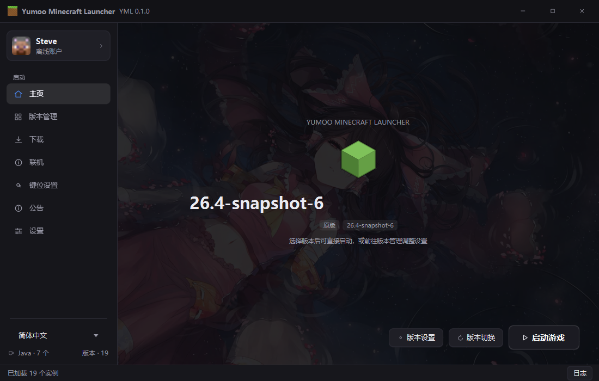
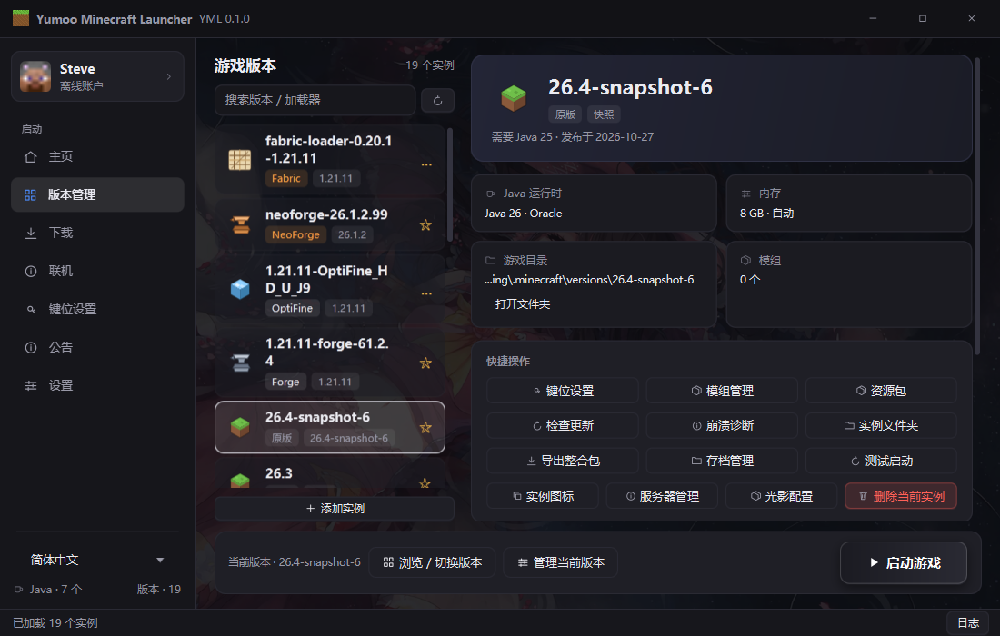
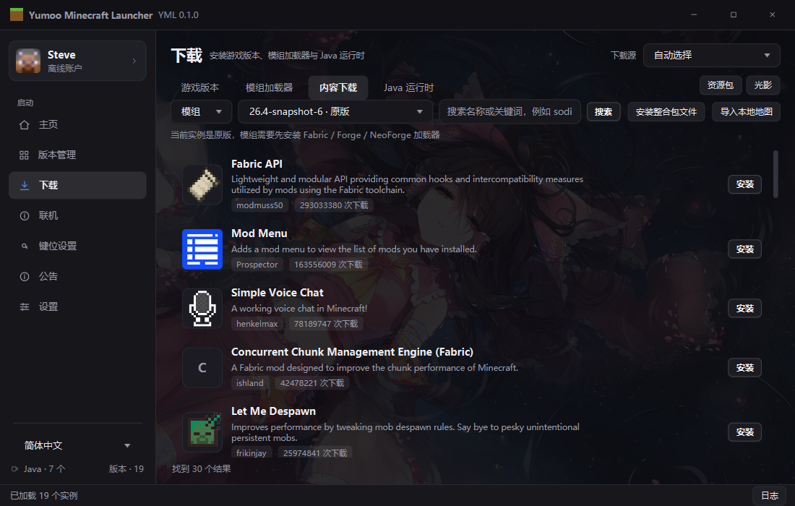
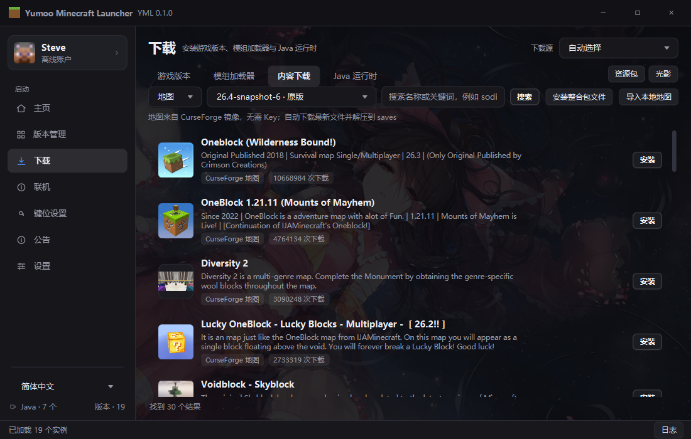

<p align="center">
  
</p>

<p align="center">
  
  
  
  
</p>

<h3 align="center">简洁、高效、属于你的 Minecraft 启动器</h3>

<p align="center">
  版本管理 · 下载中心 · 模组冲突检测 · 光影配置 · 存档与服务器 · 联机工具
</p>

> 单文件 exe，自带 Java 26 运行时，\*\*无需安装 Java\*\*。  
> 首次运行在 exe 同目录创建 `YM Launcher` 与 `.minecraft`，不写注册表。

\---

## 为什么是 YML

|开箱即用|内容齐全|出问题能查|不锁死你|
|-|-|-|-|
|一个 `YML.exe`，无需 Java、无需安装器|版本、加载器、模组、资源包、光影、整合包、地图、Java 全部内置入口|启动日志、崩溃诊断、可分享的 `.txt` 报告|支持离线、微软、外置登录；实例可隔离；配置可导入导出|

### 不止是“能启动”

* **树状版本管理**：原版 / Fabric / Forge / NeoForge /OptiFine 统一管理，支持实例隔离、自定义图标、版本收藏
* **模组冲突检测**：新旧版本、加载器不匹配、`breaks` / `type="incompatible"`、缺少前置，一眼看到问题
* **PCL2 光影配置兼容**：直接读写 `shaderpacks/<光影名>.txt`，导入/导出不转换格式
* **不用打开游戏也能管服务器**：直接编辑实例 `servers.dat`，添加/删除服务器
* **地图下载无需 Key**：CurseForge 镜像 + ForgeCDN 直链回退，同时保留本地地图导入
* **细节是活的**：页面切换交叉淡入、全局 Toast、自动 Java 选择、下载源切换

## 界面

<p align="center">
  
  
</p>
<p align="center">
  
  
</p>

## 核心功能

### 版本与启动

* 原版、Fabric、Forge、NeoForge、OptiFine
* 旧版 Forge 安装器（1.7.10 / 1.8.9 / 1.12.2）自动完成客户端安装
* 实例隔离、版本图标、收藏、测试启动、删除实例
* 自动选择 / 手动选择 Java，支持安装 Java 运行时
* 测试启动：观察 20 秒进程存活，提前退出直接提示失败

### 下载中心

* 游戏版本、模组加载器、Java 运行时
* 模组、资源包、光影、整合包、地图
* 自动加载推荐内容，默认安装到当前选中实例
* 支持官方 / BMCLAPI / 阿里云 / 清华镜像切换
* 地图支持 CurseForge 镜像与本地 zip 导入

### 模组管理

* 按 modId 合并新旧版本，不再铺满列表
* 读取 Fabric `fabric.mod.json` 与 Forge/NeoForge `mods.toml`
* 冲突检测：版本冲突、加载器不匹配、声明不兼容、缺少前置
* 顶部冲突横幅 + 每行冲突徽标 + 详情弹窗
* 启用/禁用、删除、检查更新

### 存档与服务器

* 存档管理：打开文件夹、递归删除存档
* 服务器管理：直接编辑 `servers.dat`，添加/删除服务器，启动游戏后同步

### 光影配置

* 兼容 PCL2 的光影设置文件格式：`shaderpacks/<光影名>.txt`
* 每个光影显示配置项数量
* 导入 PCL2 配置、导出当前配置、打开 shaderpacks 目录

### 账户与联机

* 离线账户、微软 OAuth 设备码、外置登录（authlib-injector）
* 联机页集成陶瓦联机官方客户端下载/启动
* 樱花 FRP Windows 客户端下载与安装入口

### 日志与诊断

* 启动日志、崩溃报告、日志文件一键打开
* 自动诊断常见问题：Java、内存、模组、网络、核心文件
* 导出可分享的 `.txt` 诊断报告，自动去除颜色控制符

### 界面

* 中文深色主题，支持自定义主题色
* 页面切换交叉淡入，不闪屏
* 全局 Toast 提示，不打断操作
* 设置修改提示、语言切换提示、下载/安装结果反馈

## 快速开始

1. 打开仓库的 **Releases** 页面，下载 `YML.exe`
2. 放到任意文件夹运行（无需安装）
3. 首次启动会在同目录创建 `YM Launcher` 和 `.minecraft`
4. 在「下载 → 游戏版本」安装版本，或在「版本管理」添加已有实例
5. 选择版本 → 启动游戏

<details>
<summary><b>启动 Minecraft 需要哪个 Java？</b></summary>

启动器自身不需要 Java；下面是游戏实例推荐版本：

|Minecraft|推荐 Java|
|-|-|
|1.7.10 / 1.8.x / 1.12.2|Java 8|
|1.16.5|Java 8 / 11|
|1.17 – 1.20.4|Java 17|
|1.20.5 – 1.21.5|Java 21|
|1.21.6+ / 26.x|Java 21 / 25|

可以在「下载 → Java 运行时」中下载，或在实例设置里手动选择。

</details>

## 从源码构建

要求：

* Windows 10/11 x64
* **JDK 26**（`JAVA\_HOME` 指向 JDK 26）
* PowerShell 5.1+ / PowerShell 7
* 打包 exe 需要 JDK 的 `jlink`、`jpackage` 与 .NET Framework `csc.exe`

```powershell
git clone <your-repo-url>
cd <repo>

.\\build.ps1
.\\run.ps1

# jar + YML.bat
.\\package.ps1

# jpackage app-image
.\\package-exe.ps1

# 单文件 exe，公开发布只包含普通用户端
.\\package-single.ps1 -Version 1.0.0 -NoAdmin
```

仓库已包含 Windows x64 的 JavaFX 26 运行库（`lib/javafx`）。产物在 `dist/`。

## 发布策略

GitHub Release **只发布普通用户端**：

* `YML.exe`
* `SHA256SUMS.txt`
* `LICENSE`
* `README.md`

管理员端 `YML-Admin.exe` 不公开提供。维护者本地需要时：

```powershell
.\\package-single.ps1 -Version 1.0.0
```

管理员密码不写入源码，使用环境变量或数据目录文件配置：

```powershell
$env:YML\_ADMIN\_VERSION\_PASSWORD = "..."
$env:YML\_ADMIN\_ANNOUNCEMENT\_PASSWORD = "..."
```

未配置时管理员验证默认拒绝。

## 信任与校验

本项目**不做代码签名**，也不承诺消除 SmartScreen 警告。每个 Release 提供 `SHA256SUMS.txt`：

```powershell
Get-FileHash .\\YML.exe -Algorithm SHA256
Get-Content .\\SHA256SUMS.txt
```

启动器会下载 jar、读写 `.minecraft`、启动 Java 进程，启发式杀毒可能误报。请先核对哈希并确认来源；不放心可以自行构建。

## 项目结构

```
src/main/java          Java 源码
src/main/resources     主题与图标
lib/javafx             JavaFX 26 Windows x64
tools/Bootstrap.cs     单文件 exe 引导器
assets/                应用图标
docs/                  README 横幅与截图
.github/workflows/     CI 与 Release
```

## 参与贡献

见 [CONTRIBUTING.md](CONTRIBUTING.md)。提交前请确认：

* `.\\build.ps1` 通过
* 不包含密码、令牌、个人路径、构建产物
* UI 改动附截图

安全问题请按 [SECURITY.md](SECURITY.md) 私下报告。

## 许可证

GPL-3.0，详见 [LICENSE](LICENSE) 与 [THIRD\_PARTY\_NOTICES.md](THIRD_PARTY_NOTICES.md)。

\---

<p align="center">
  <sub>YML 1.0.0 · 与 Mojang Studios、Microsoft 无隶属关系。Minecraft 是 Mojang Studios 的商标。</sub>
</p>

